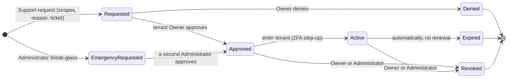
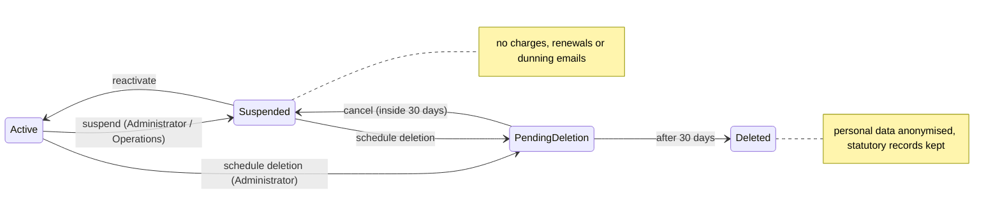
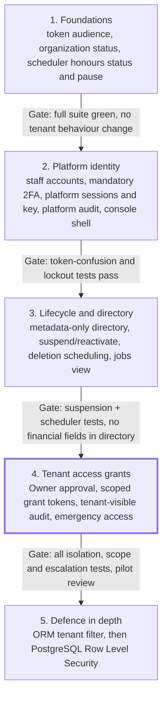

# Rooman Billing — Platform Administration Design

Sep 29, 2026 · @Kalpit Das

Rooman Billing should add a **separate, audited platform layer** — its own staff identity, its own tokens, and time-limited Tenant Access Grants — rather than a Super Admin that bypasses `organization_id` filtering. This is a design and security review only: no code, migration, commit or production change was made. Reviewed against `main` at `19a7dc4` (PR #26 and PR #27 merged). Decisions that need business sign-off are listed in section 20.

## 1. Current architecture verified

Everything below was re-read on current `main`, not taken from the earlier audit.

| Area | What the code does today | Where |
| --- | --- | --- |
| User | One global account per email: password hash, `is_active`, lockout (`failed_login_attempts`, `locked_until`), `tokens_valid_after` for mass revocation, optional TOTP (`totp_secret`, `totp_enabled_at`, `totp_last_used_step`) | `models/identity.py` |
| Membership | `(organization_id, user_id)` unique; `role` (MemberRole), `status` (active/invited/deactivated); cascades with the organization and the user | `models/identity.py` |
| Organization | Profile, numbering series, tax and discount defaults. **No status or lifecycle field** | `models/identity.py` |
| Sessions | `RefreshToken` row per sign-in (hashed, rotating via `replaced_by_id`, revocable), optionally bound to an organization | `models/identity.py` |
| Access token | HS256 JWT signed with the single `SECRET_KEY`: `sub`, `org`, `role`, `type=access`, `iat`, `exp` (30 min), `jti`, `sid`. **No `aud` or `iss`**; token kinds are told apart only by `type` | `core/security.py` |
| Tenant context | `get_current_context` loads the caller's **active Membership from the database** for the token's `org`; role comes from that row, not the token; access token also dies with its revoked session (`sid`) | `api/deps.py` |
| RBAC guards | `require_viewer / finance / admin / owner` rank checks; 311 of 356 routes use them | `api/deps.py` |
| Org switching | `POST /auth/switch-organization` issues new tokens only if the user has an active membership in the target org | `services/auth_service.py` |
| 2FA | TOTP enrolment and an MFA challenge token at login — **optional**, enforced only for users who enrolled | `services/auth_service.py`, `endpoints/auth.py` |
| Customer portal | Separate principal `CustomerPortalUser` with an opaque DB-backed session token (`X-Portal-Token`), scoped to one organization and one customer | `endpoints/portal.py` |
| Public links | Quote, invoice and checkout pages resolved by an unguessable per-document token; no staff session | `endpoints/public_*.py`, `hosted_checkout.py` |
| Audit | `AuditLog` with nullable `organization_id` **ON DELETE CASCADE**; actor user, label, action, before/after JSON, IP, user agent | `models/governance.py`, `services/audit.py` |
| /admin router | Empty; its docstring records that `POST /admin/jobs/run` was removed because any tenant owner could run billing jobs for every tenant | `endpoints/admin.py` |
| Scheduler | Separate process; PostgreSQL advisory lock; loops over **all** organizations for 8 steps (plan changes, trial charging, renewals, overdue, dunning emails, dunning charge retries, recurring expenses, housekeeping). No org-status check | `services/scheduler.py` |
| Frontend auth | Staff and portal tokens kept in `localStorage`; `RequireAuth`, `RequireRole min=…` and `PublicOnly` guards; `switchOrganization` in `useAuth` | `services/apiClient.ts`, `routes/index.tsx`, `hooks/useAuth.tsx` |
| Database | PostgreSQL 16 in production and CI; SQLite for local tests | `docker-compose.prod.yml`, `ci.yml` |

## 2. Current RBAC

There are four roles, all tenant-scoped through `Membership`; there is no platform role, superuser or staff flag anywhere in models, backend, frontend or seed data.

| Role | Rank | Can do (minimum role per area on `main`) |
| --- | --- | --- |
| Owner | 40 | Everything Admin can, plus grant, remove or transfer the Owner role (`organization_service.py`) |
| Admin | 30 | Team and roles, organization settings, integrations (encrypted SMTP/Razorpay credentials), approvals, audit logs, customization, voids and admin overrides |
| Finance | 20 | Create and edit customers, quotes, invoices, payments, subscriptions, credit notes, dunning cases, imports |
| Viewer | 10 | Read-only across the tenant |

No endpoint is guarded by `require_owner`; owner-only rules live inside `organization_service.py`. There is no Sales role. Customer portal users are a separate principal and never hold a `MemberRole`.

## 3. Current tenant isolation

Isolation holds at the API boundary today, but it rests entirely on hand-written query filters with no second line of defence.

- **Context:** the JWT `org` claim selects the tenant; `get_current_context` refuses the request unless an active `Membership` exists for that user and org. Role is read from that row.
- **Coverage:** 311 staff routes use the role guards. The other 45 are auth/signup, health/meta, token-scoped public pages, the Razorpay webhook and the portal (own principal). No route is authenticated but tenant-less.
- **Client-supplied org:** only `switch-organization`, which is membership-checked.
- **Enforcement:** 80 tables carry `TenantMixin`; about 549 explicit `organization_id` filters across 58 service files. `TenantMixin` states that every query "MUST filter" — there is no ORM global filter and no PostgreSQL Row Level Security.
- **Known soft spots:** primary-key lookups such as `db.get(Invoice, promise.invoice_id)` trust that the parent row was already tenant-scoped; one missed filter in a new endpoint would leak across tenants silently.
- **Cross-tenant actor:** only the scheduler, as a separate process with no HTTP surface.

The design below keeps every one of these checks and adds platform access beside them, never through them.

## 4. Proposed platform role model

Four platform roles, none of which can read tenant financial data or customer PII by standing permission; that access exists only through a grant (section 6).

| Role | Purpose | Tenant metadata | Tenant financial data / PII | Manage platform staff | Suspend org | Revoke sessions | Approve emergency access | Tenant support access |
| --- | --- | --- | --- | --- | --- | --- | --- | --- |
| Platform Administrator (Platform Owner) | Owns the platform: staff, settings, break-glass | Read | Only via an emergency grant (second admin approves) | Yes: create, disable, change roles (not their own) | Yes, with reason | Yes: any staff, any tenant user | Yes (never their own request) | Via grant |
| Platform Operations | Tenant lifecycle and platform health | Read | No | No | Yes, with reason | Tenant user sessions for a named org, with reason | No | No |
| Platform Support | Investigate customer issues | Read | Only via a tenant-approved grant, scoped and time-limited | No | No | No | No | Via grant |
| Security & Compliance (optional) | Oversight and incident review | Read | No | No | No (can request) | Yes: emergency lockout of any staff or tenant user | No | No |

Rules that apply to every platform role:

- No role can grant itself a role, approve its own grant, or extend its own grant.
- Creating or promoting a Platform Administrator needs a second Platform Administrator to approve.
- Metadata means directory data only: organization name, slug, status, created date, owner contact email, member and document **counts**, integration health flags. It never includes amounts, customer names, line items or payment details.
- Operations and Security can view scheduler status; only Platform Administrator can pause jobs for a tenant (section 16).

## 5. Platform authentication

Platform staff should be a **separate principal with its own table, credentials, signing key and token audience**, never a flag on `User` and never a `Membership`.

**Why a separate principal rather than the shared `User` table**

- A tenant-side weakness (signup, invitation acceptance, password reset, a leaked tenant password) can then never produce a platform credential.
- Tenant code that loads `User` by id cannot accidentally see a platform flag and skip a check.
- Stricter rules (mandatory 2FA, short sessions, lockout) apply without changing tenant behaviour.
- Cost: a person who is also a tenant user holds two accounts. Recommend a company-domain email for platform accounts (for example `@rooman.com`), distinct from any tenant login.

**Tokens**

| Property | Tenant access token (today → proposed) | Platform access token (new) |
| --- | --- | --- |
| Signing key | `SECRET_KEY` | New `PLATFORM_JWT_SECRET`, different from `SECRET_KEY` |
| `aud` | none → `tenant` (required after one 30-minute rollover window) | `platform` |
| `iss` | none → `rooman-billing` | `rooman-billing-platform` |
| `typ` | `access` | `platform_access` |
| `sub` | user id | platform staff id |
| `sid` | refresh-token row | platform session row |
| `org` | organization | **absent** — a platform token has no tenant context |
| Other | `role` (informational) | `amr` = `["pwd","otp"]` or `["pwd","webauthn"]`, `auth_time` |
| Lifetime | 30 minutes | 10 minutes |

Each decoder checks key, `aud`, `iss` and `typ` together. A tenant token therefore fails signature verification on platform routes, and a platform token fails on tenant routes, even if one check were later forgotten. Roles are always reloaded from the database, as tenant roles are today.

**Sessions and 2FA**

- 2FA is **mandatory**: a new staff account can do nothing until TOTP (minimum) or a WebAuthn key (preferred) is enrolled. Recovery codes are single-use and hashed.
- Opaque refresh token in a `platform_sessions` table, rotated on every use; idle timeout 30 minutes, absolute lifetime 8 hours, no "remember me".
- Step-up: sensitive actions (approve a grant, emergency access, suspend, staff role change) need a fresh 2FA code from the last 5 minutes.
- Revocation: per session, all sessions of one staff member (`tokens_valid_after`), or disabling the account; every check happens on each request, as `get_current_user` does today.
- The console is served from its own origin (for example `platform.<domain>`) with the session in an `HttpOnly`, `Secure`, `SameSite=Strict` cookie plus CSRF token. Tenant tokens live in `localStorage` today, so a separate origin keeps an XSS in the tenant app away from platform credentials.
- Optional, recommended: restrict `/platform` to a VPN or IP allowlist at the reverse proxy.

## 6. Tenant access grants

Platform staff reach tenant data only through a grant: one organization, named scopes, a reason, a ticket, a short expiry, and — outside emergencies — the tenant Owner's approval.

Only the Active state reaches tenant data; every path out of it ends access on the next request, and support cannot restart an expired or revoked grant.

**How a grant is used**

1. Support creates the request in the console (organization, scopes, duration, reason, ticket).
2. Every active Owner of that organization is notified in-app and by email; any one Owner approves or denies. Admins can approve only if the business decides so (section 20).
3. On approval nothing is issued yet. When support clicks **Enter tenant**, the backend verifies the grant is `approved`, unexpired and unrevoked, requires a fresh 2FA step-up, and issues a **grant token**: `aud=tenant`, `typ=grant_access`, `sub=<platform staff id>`, `org=<grant org>`, `gid=<grant id>`, `scp=[…]`, `exp` = the earlier of 15 minutes or grant expiry.
4. `get_current_context` recognises `typ=grant_access`, reloads the grant from the database on **every** request (status, expiry, org match, staff still active) and builds a context whose principal is the platform staff member, with `acting_as=platform_support`, the grant id and its scopes. No `Membership` is created or faked.
5. Routes declare the scope they need (for example `READ_INVOICES`); a grant context without it gets 403, and routes that declare no scope are closed to grant contexts by default.
6. Every request under a grant writes a platform audit row and a tenant-visible audit row (sections 10 and 11).
7. The grant ends at expiry, on revoke by the tenant Owner, on revoke by the requester or a Platform Administrator, or when the staff account is disabled — the next request fails.

**TenantAccessGrant fields**

| Field | Meaning |
| --- | --- |
| `id` | UUID |
| `organization_id` | Target tenant (the only org the grant can reach) |
| `requested_by_staff_id` | Platform staff who asked |
| `approved_by_user_id` / `approved_by_staff_id` | Tenant Owner who approved, or the second Platform Administrator for emergencies (exactly one is set) |
| `status` | `pending`, `approved`, `denied`, `active`, `expired`, `revoked` |
| `scopes` | List of scope names (section 7) |
| `can_write` | Derived: true only if a `WRITE_*` scope is present |
| `reason` | Free text, required, 20 characters minimum |
| `ticket_ref` | Support ticket or incident id, required |
| `requested_duration_minutes` | Asked for; capped by policy (default 60, maximum 240) |
| `is_emergency` | Break-glass grant (section 12) |
| `created_at`, `approved_at`, `first_used_at`, `expires_at`, `revoked_at` | Lifecycle times; `expires_at` is set at approval |
| `revoked_by_kind`, `revoked_by_id`, `revoke_reason` | Who ended it early and why |
| `denied_reason` | Optional note from the Owner |

Support cannot extend a grant: a longer window means a new request and a new approval.

## 7. Access scopes

Default grants are read-only; write scopes are few, narrow and never touch money movement.

| Scope | Allows (tenant endpoints) | Default in a support request |
| --- | --- | --- |
| `READ_METADATA` | Organization settings, team list (names, roles), integration status flags | Always included |
| `READ_CUSTOMERS` | Customers and contacts (PII) | Opt-in |
| `READ_QUOTES` | Quotes, quote PDFs, approvals on quotes | Opt-in |
| `READ_INVOICES` | Invoices, invoice PDFs, credit notes | Opt-in |
| `READ_PAYMENTS` | Payments, refunds, allocations, dunning cases — masked payment-method details only | Opt-in |
| `READ_SUBSCRIPTIONS` | Subscriptions, plans, trials, usage | Opt-in |
| `READ_AUDIT` | The tenant's own audit log | Opt-in |
| `READ_CONFIG` | Templates, automation rules, portal settings (never credential values) | Opt-in |
| `WRITE_CUSTOMERS` | Edit customer profile and contact fields | Opt-in, tenant Owner sees it flagged |
| `WRITE_QUOTES` | Edit **draft** quotes only | Opt-in, flagged |
| `WRITE_CONFIG` | Fix templates, automation rules, numbering prefixes | Opt-in, flagged |
| `WRITE_SUBSCRIPTIONS` | Non-financial fields only (notes, reference, contact) | Opt-in, flagged |

No `WRITE_INVOICES` or `WRITE_PAYMENTS` scope is offered at all.

**Impossible under any support grant (including emergency) — the route refuses grant contexts outright**

- Record, refund, void, reverse or allocate payments; issue credit notes; create or charge Razorpay orders.
- Create, send, void, delete or re-open invoices; change invoice amounts or tax.
- Approve discounts, admin quote overrides (`mark-accepted` / `mark-declined`), converting quotes to invoices or subscriptions.
- Change plan prices, subscription amounts, trial charging, or trigger renewals and dunning retries.
- Read or change integration credentials (SMTP, Razorpay keys, webhook secrets); export or bulk-download data.
- Invite, remove or re-role tenant members; change the Owner; enable or reset a tenant user's 2FA; delete the organization.

If a tenant needs one of these done, their own Owner, Admin or Finance user does it while on a call with support. Whether any financial write should ever be possible under an emergency grant is a business decision (section 20); this design recommends **no**.

## 8. Organization lifecycle

Add `Organization.status` with four lifecycle states (plus the two signup approval states described after the table). Suspension **freezes all money movement first**, then limits access, so a suspended tenant is never charging its customers in the background.

Suspension and reactivation are reversible and need a reason; deletion always passes through a cancellable waiting period, and the platform audit outlives the tenant.

**Who can move an organization between states**

| Transition | Who | Requirements |
| --- | --- | --- |
| Active → Suspended | Platform Administrator or Platform Operations | Reason + ticket, 2FA step-up; tenant Owners emailed |
| Suspended → Active | Platform Administrator or Platform Operations | Reason; scheduler catch-up rules below |
| Active or Suspended → Pending deletion | Platform Administrator, or the tenant Owner's own request confirmed by a Platform Administrator | Reason + ticket; waiting period starts (proposed 30 days) |
| Pending deletion → Suspended | Platform Administrator | Cancels deletion inside the waiting period |
| Pending deletion → Deleted | Automatic at the end of the waiting period, after a final Platform Administrator confirmation | Data purge per retention policy |

**What each state means**

| Area | Active | Suspended | Pending deletion | Deleted |
| --- | --- | --- | --- | --- |
| Tenant staff sign-in and API | Normal | Owner and Admin read-only, with a suspension banner; Finance and Viewer refused | Owner read-only, data export only | Impossible |
| Customer portal | Normal | Read-only (view invoices); no payments, no plan or card changes | Refused | Refused |
| Public quote links | Normal | Viewable with "temporarily unavailable"; accept and decline refused | Refused (link invalid) | Refused |
| Public invoice and checkout links | Normal | Viewable; **no new payments or Razorpay orders** | Refused | Refused |
| Razorpay webhooks | Processed | **Still processed** — money already captured must be recorded | Processed, then flagged for manual review | Logged to platform audit only |
| Scheduler: renewals, trial charging, dunning charge retries, scheduled plan changes | Run | **Skipped** | Skipped | Skipped |
| Scheduler: dunning and reminder emails, recurring expenses | Run | Skipped | Skipped | Skipped |
| Scheduler: marking invoices overdue | Run | Skipped (clock frozen; decision in section 20) | Skipped | Skipped |
| Outbound email from the tenant | Normal | Only suspension notices to the tenant's Owners | Only deletion notices | None |
| Data | Intact | Intact, unchanged | Intact, exportable by Owner | Purged or anonymised per retention; organization row kept as a tombstone |
| Platform audit | Kept | Kept | Kept | **Kept** (not tied to the tenant row) |

**Approval states (signup):** a self-service signup creates the organization in **Pending approval**. Only a Platform Administrator (2FA step-up) can move it to **Active** (approve) or **Rejected** (reject, mandatory reason shown to the tenant). Both states are treated as non-operational everywhere:

| Area | Pending approval | Rejected |
| --- | --- | --- |
| Tenant staff sign-in and API | Sign-in and `/auth/me` work; every business endpoint returns 403 `ORGANIZATION_PENDING_APPROVAL`; the SPA shows an "awaiting approval" screen | Same, with 403 `ORGANIZATION_REJECTED` and the rejection reason on screen |
| Customer portal, public quote / invoice / checkout links | Refused (link invalid) | Refused (link invalid) |
| Scheduler (money and email) | Skipped | Skipped |
| Platform console | Dashboard callout + "Pending approval" filter; Approve / Reject on the organization page | Visible in the directory; no lifecycle actions |

Migration 0033's downgrade demotes both states to Suspended (never Active), so a downgrade can never grant access to an unapproved organization.

**Reactivation catch-up:** on Suspended → Active the scheduler does **not** replay missed renewals or charges automatically. Missed periods appear in a "resume review" list that the tenant Owner confirms, so customers are not surprise-charged for the suspension window.

**Deletion and retention:** Indian GST rules require keeping invoices and payment records for several years, so "deleted" should mean personal data anonymised and access removed, with statutory financial records retained. The exact retention period needs legal sign-off (section 20).

## 9. Platform console

A separate app at `/platform` on its own origin; no page shows tenant amounts, customer names or line items — that data is only reachable by entering a tenant under a grant.

| Page | Who can open it | Shows | Actions | Tenant financial / customer data |
| --- | --- | --- | --- | --- |
| Dashboard | All platform roles | Tenant counts by status, sign-ups this week, open grants, failed jobs, integration health alerts | Links only | None (counts only) |
| Organizations | All platform roles | Directory: name, slug, status, created, owner contact email, member count, document counts, last activity date, integration flags | Suspend, reactivate (Admin, Operations); schedule or cancel deletion (Admin); revoke all tenant sessions (Admin, Operations); request access (Support, Admin) | None |
| Organization detail | All platform roles | The directory fields, lifecycle history, grant history, platform audit for this org | As above | None |
| Platform Staff | Platform Administrator; Security & Compliance read-only | Staff, roles, 2FA status, last sign-in, active sessions | Invite, disable, change role (needs a second Administrator for Administrator role), reset 2FA (second Administrator), revoke sessions | None |
| Access Grants | Support (own requests), Administrator and Security (all) | Requests, approvals, active grants with expiry countdown | Request, cancel own; Administrator revokes any; **Enter tenant** for an active grant | None on this page |
| Tenant workspace (under a grant) | The grant holder only | The normal tenant app, limited to granted scopes, with a fixed banner: organization, scopes, time left, "Exit" | Only what the scopes allow | Yes, within scope, fully audited |
| System Health | All platform roles | `/health` and readiness, database and migration status, email and Razorpay reachability, error rates | None | None |
| Jobs / Scheduler | Administrator, Operations, Security (read) | Last and next run, per-step counts and failures, lock holder, tenants skipped because suspended | Pause or resume scheduling for one tenant (Administrator); nothing else | None (counts and ids) |
| Security & Audit | Administrator, Security | Platform audit log, failed sign-ins, emergency grants, alerts | Export (Security), lock out an account | None |
| Platform Settings | Administrator | Grant duration limits, deletion waiting period, session limits, alert recipients | Edit (2FA step-up, audited) | None |

Secrets (SMTP, encryption keys, Razorpay) stay in deployment configuration and are never shown or editable in the console.

## 10. Platform audit

A new append-only `platform_audit_logs` table records every platform action; it has **no foreign key to `organizations`**, so deleting a tenant can never delete its platform history.

| Field | Notes |
| --- | --- |
| `id` | UUID |
| `occurred_at` | UTC, indexed |
| `platform_staff_id` | Nullable only for failed sign-ins with an unknown email; FK to `platform_staff` with `ON DELETE RESTRICT` (staff are disabled, never deleted) |
| `staff_email_snapshot`, `staff_role_snapshot` | Copied at write time so the row stays readable if the account changes |
| `action` | See the event list |
| `target_type`, `target_id` | For example `organization`, `grant`, `staff`, `invoice` |
| `organization_id` | Plain indexed column, **no FK**, so it survives tenant deletion |
| `organization_name_snapshot` | For readability after deletion |
| `access_grant_id` | Plain column, set for anything done under a grant |
| `reason`, `ticket_ref` | Required for every state-changing action |
| `request_method`, `request_path` | For tenant data accessed or modified under a grant |
| `result` | `success`, `denied`, `error` |
| `ip_address`, `user_agent`, `session_id` | As in today's `AuditLog` |
| `details` | JSON, with secrets and card data never stored |
| `prev_hash`, `row_hash` | Optional hash chain so tampering is detectable |

The application's database role gets `INSERT` and `SELECT` only on this table: no `UPDATE`, no `DELETE`. Retention: at least 7 years, in line with financial-record retention (confirm in section 20).

**Events**

- Authentication: `PLATFORM_LOGIN_SUCCEEDED`, `PLATFORM_LOGIN_FAILED`, `PLATFORM_2FA_ENROLLED`, `PLATFORM_2FA_FAILED`, `PLATFORM_2FA_RESET`, `PLATFORM_STEP_UP_SUCCEEDED`, `PLATFORM_SESSION_REVOKED`, `PLATFORM_ACCOUNT_LOCKED`
- Staff: `PLATFORM_STAFF_INVITED`, `PLATFORM_STAFF_ACTIVATED`, `PLATFORM_STAFF_ROLE_CHANGED`, `PLATFORM_STAFF_DISABLED`, `PLATFORM_STAFF_REENABLED`
- Organizations: `ORGANIZATION_VIEWED`, `ORGANIZATION_SUSPENDED`, `ORGANIZATION_REACTIVATED`, `ORGANIZATION_DELETION_SCHEDULED`, `ORGANIZATION_DELETION_CANCELLED`, `ORGANIZATION_DELETED`, `TENANT_SESSIONS_REVOKED`, `TENANT_JOBS_PAUSED`, `TENANT_JOBS_RESUMED`
- Grants: `ACCESS_GRANT_REQUESTED`, `ACCESS_GRANT_APPROVED`, `ACCESS_GRANT_DENIED`, `ACCESS_GRANT_ENTERED`, `ACCESS_GRANT_REVOKED`, `ACCESS_GRANT_EXPIRED`
- Under a grant: `TENANT_DATA_ACCESSED` (one row per request: path, scope, record ids returned), `TENANT_DATA_MODIFIED` (with before/after), `TENANT_ACCESS_DENIED` (scope missing or forbidden route)
- Emergency: `EMERGENCY_ACCESS_REQUESTED`, `EMERGENCY_ACCESS_APPROVED`, `EMERGENCY_ACCESS_USED`, `EMERGENCY_ACCESS_REVIEWED`
- Settings: `PLATFORM_SETTING_CHANGED`

## 11. Tenant-visible audit

Every grant event and every action under a grant is **mirrored into the tenant's own `AuditLog`**, attributed to the platform staff member — never to the tenant's Owner, Admin or Finance user.

- `actor_user_id` stays empty (the actor is not a tenant user); `actor_label` = `Rooman Platform Support — <staff name>`.
- New actions: `PLATFORM_ACCESS_REQUESTED`, `PLATFORM_ACCESS_APPROVED`, `PLATFORM_ACCESS_DENIED`, `PLATFORM_ACCESS_STARTED`, `PLATFORM_ACCESS_ENDED`, `PLATFORM_ACCESS_REVOKED`, plus the ordinary action name (for example `CUSTOMER_UPDATED`) for anything changed under a grant.
- `after_state` carries `actor_type=platform_support`, `platform_staff_id`, `platform_role`, `access_grant_id`, `scopes`, `reason`, `ticket_ref`, `expires_at`, `emergency`.
- Reads are summarised, not logged per request, on the tenant side: one `PLATFORM_ACCESS_ENDED` row lists the areas viewed and the number of records opened. The platform log keeps the per-request detail.
- A **Platform access** tab in the tenant's Settings → Security lists current and past grants: staff name, role, reason, ticket, scopes, start, expiry, end, and the actions performed, with a **Revoke now** button for active grants.
- While a grant is active, tenant Owners and Admins see a banner: "Rooman Platform Support (\<name>) has read access to Customers and Invoices until 15:40 — ticket SUP-1234."
- Tenant Owners get an email when a grant is requested, approved, used for the first time, and ended.

These mirrored rows use the existing `AuditLog` table, so they do cascade if the tenant is deleted — the platform audit is the permanent copy.

## 12. Emergency access

Break-glass exists for incidents where the tenant Owner cannot be reached (active fraud, data corruption, a security incident); it replaces the Owner's approval with a **second Platform Administrator's approval**, never with no approval.

1. A Platform Administrator opens an emergency request: organization, scopes (read scopes only by default), reason, incident or ticket id — all mandatory.
2. A **different** Platform Administrator approves with a fresh 2FA step-up. Recommended: required. If only one Administrator exists, the request cannot be approved and escalates by phone to the company's named security contact (decision in section 20).
3. The grant lasts at most 60 minutes, cannot be extended, and is marked `is_emergency=true`.
4. On approval, alerts go immediately to all Platform Administrators, the Security & Compliance role and the ops alert channel (`core/alerts` already exists), and every Owner of the tenant is emailed.
5. Everything done is logged per request in both audits, flagged emergency.
6. Within 5 working days, a post-incident review is recorded against the grant (`EMERGENCY_ACCESS_REVIEWED`); unreviewed emergency grants show as overdue on the Security page.

Emergency access does **not** unlock the financial actions listed as impossible in section 7.

## 13. Tenant isolation / RLS recommendation

Recommendation: first add a **central ORM tenant filter** driven by the request context, then add **PostgreSQL Row Level Security as the backstop** on the most sensitive tables. Keep all existing explicit filters; neither layer replaces them.

| Criterion | A. ORM global filter (`do_orm_execute` + `with_loader_criteria`) | B. PostgreSQL RLS | C. Repository layer / lint only |
| --- | --- | --- | --- |
| Security | Catches forgotten filters in ORM queries; bypassed by raw SQL and Core `update()`/`delete()` unless extended | Enforced by the database for every query, raw SQL included; strongest | Depends on discipline; a test or lint can miss dynamic queries |
| Fit with current code | Good: 80 `TenantMixin` models, `CurrentContext` already exists; a contextvar holds the org | Medium: services commit several times per request (for example `expire_stale_quotes` commits, then work continues), so the org setting must be re-applied at each transaction start via an `after_begin` hook using `SET LOCAL` | Good, but a large refactor of 58 service files |
| Background jobs | Scheduler runs in an explicit `system_context()`; per-org steps can set the org to keep the filter on | Scheduler needs its own DB role with `BYPASSRLS`, or sets the org per iteration (preferred) | Unchanged |
| Migrations | None | One migration per table: `ENABLE ROW LEVEL SECURITY` + policy; app role must not own the tables | None |
| Performance | Adds a `WHERE organization_id = ?` already present in most queries; negligible | Small per-query cost; `organization_id` is already indexed | None |
| Testing | Runs on SQLite and PostgreSQL | PostgreSQL only; CI already runs PostgreSQL 16 | Static checks |
| Grants | Grant context sets the grant's org; scope checks stay in the route layer | Same setting; platform cross-tenant counts need a separate read-only role or `SECURITY DEFINER` count views | Same |
| Risk of breaking things | Medium: some legitimate cross-tenant reads (scheduler, public token lookups) must opt out explicitly | Higher: a missing setting returns zero rows or errors in production | Low |

Why this order for Rooman Billing:

- Public token pages (quotes, invoices, checkout) and the Razorpay webhook find the organization **from** the token or payment, so they need an explicit, audited `resolve-then-scope` step. Doing that in the ORM layer first shakes out every such path under tests before the database starts refusing rows.
- RLS then protects the tables where a leak hurts most — invoices, invoice items, payments, refunds, customers, quotes, subscriptions, credit notes, payment methods, integrations — without touching platform tables, which are not tenant-scoped.
- Platform metadata (directory, counts) is served from a narrow read-only role or views that expose only aggregates, so the platform API never needs a bypass on tenant tables.

## 14. API design

Two new surfaces: `/api/v1/platform/*`, which only a platform token can call, and a small set of tenant-side endpoints for Owners to see and decide on grants. The existing error envelope, `PaginatedResponse` and router registration in `api_router.py` stay as they are.

**Platform API (platform token, `aud=platform`)**

| Method and path | Minimum role | Notes |
| --- | --- | --- |
| `POST /platform/auth/login` | none | Email + password; returns a 2FA challenge, never a session |
| `POST /platform/auth/2fa` | challenge | TOTP or WebAuthn; sets the session cookie |
| `POST /platform/auth/2fa/enroll` | first sign-in | Mandatory before any other call |
| `POST /platform/auth/step-up` | any | Fresh 2FA for sensitive actions (valid 5 minutes) |
| `POST /platform/auth/refresh` | session | Rotates the refresh token |
| `POST /platform/auth/logout` | session | Revokes this session |
| `GET /platform/me` | any | Own profile, role, sessions |
| `GET /platform/organizations` | any | Directory (metadata only), filters: status, created, search by name/slug |
| `GET /platform/organizations/{id}` | any | Metadata, lifecycle and grant history |
| `POST /platform/organizations/{id}/suspend` | Operations | Body: reason, ticket\_ref; step-up |
| `POST /platform/organizations/{id}/reactivate` | Operations | Body: reason |
| `POST /platform/organizations/{id}/schedule-deletion` | Administrator | Body: reason, ticket\_ref; step-up |
| `POST /platform/organizations/{id}/cancel-deletion` | Administrator | Body: reason |
| `POST /platform/organizations/{id}/revoke-sessions` | Operations | Revokes all tenant user and portal sessions for that org |
| `POST /platform/organizations/{id}/jobs/pause` · `/resume` | Administrator | Per-tenant scheduler pause flag; never runs jobs |
| `GET /platform/staff` | Administrator, Security | List |
| `POST /platform/staff` | Administrator | Invite; Administrator role needs a second approval |
| `PATCH /platform/staff/{id}` | Administrator | Role, active flag; not on self |
| `POST /platform/staff/{id}/revoke-sessions` | Administrator, Security |  |
| `POST /platform/staff/{id}/reset-2fa` | Administrator + second approval |  |
| `POST /platform/staff/{id}/lock` | Administrator, Security | Emergency lockout |
| `GET /platform/access-grants` | Support (own), Administrator, Security (all) |  |
| `POST /platform/access-grants` | Support, Administrator | Body: organization\_id, scopes, duration, reason, ticket\_ref |
| `POST /platform/access-grants/{id}/cancel` | requester | Before approval |
| `POST /platform/access-grants/{id}/revoke` | requester, Administrator |  |
| `POST /platform/access-grants/{id}/enter` | grant holder | Step-up; returns a short grant token for the tenant API |
| `POST /platform/emergency-grants` | Administrator | Break-glass request |
| `POST /platform/emergency-grants/{id}/approve` | a different Administrator | Step-up |
| `POST /platform/emergency-grants/{id}/review` | Administrator, Security | Post-incident record |
| `GET /platform/jobs` | Administrator, Operations, Security | Scheduler status and per-step results |
| `GET /platform/health` | any | Aggregated health |
| `GET /platform/audit` | Administrator, Security | Filters: staff, organization, action, date; export for Security |
| `GET /platform/settings` · `PATCH` | Administrator | Grant limits, waiting periods; step-up |

**Tenant-side (tenant token, Owner unless noted)**

| Method and path | Role | Notes |
| --- | --- | --- |
| `GET /organization/platform-access` | Admin | Current and past grants for this organization |
| `POST /organization/platform-access/{id}/approve` | Owner | Step-up if the Owner has 2FA; sets expiry |
| `POST /organization/platform-access/{id}/deny` | Owner | Optional reason |
| `POST /organization/platform-access/{id}/revoke` | Owner, Admin | Ends an active grant immediately |

There is deliberately **no** endpoint that runs billing jobs, no "login as user" endpoint, and no platform endpoint that returns invoices, payments or customers directly.

## 15. Database design

Five new tables plus four columns on `organizations`, all following existing conventions (`String(36)` UUID keys, `TimestampMixin`, SQLAlchemy `Enum`). None of the platform tables use `TenantMixin`, and none cascade from `organizations`.

**`platform_staff`**

| Column | Type and constraints |
| --- | --- |
| `id` | PK, UUID |
| `email` | `String(254)`, unique, lower-cased |
| `full_name` | `String(200)` |
| `hashed_password` | Same hashing as `User` |
| `role` | Enum `platform_role`: `platform_administrator`, `platform_operations`, `platform_support`, `security_compliance` (one role per person keeps reviews simple; a separate roles table is not needed yet) |
| `status` | Enum: `invited`, `active`, `disabled`, `locked`; indexed |
| `totp_secret` (encrypted with the existing Fernet keyring), `totp_enabled_at`, `totp_last_used_step` | 2FA; `totp_enabled_at` must be set before `status=active` |
| `webauthn_credentials` | JSON, optional |
| `failed_login_attempts`, `locked_until`, `last_login_at`, `tokens_valid_after` | As on `User` |
| `invited_by_staff_id` | FK `platform_staff.id`, `ON DELETE RESTRICT` |
| `disabled_at`, `disabled_by_staff_id`, `disabled_reason` | Soft disable; rows are **never deleted** |

**`platform_sessions`** — `id` PK; `staff_id` FK `platform_staff` `ON DELETE RESTRICT`, indexed; `token_hash` unique; `created_at`, `last_used_at`, `idle_expires_at`, `absolute_expires_at`; `revoked_at`, `replaced_by_id`, `revoke_reason`; `ip_address`, `user_agent`; `step_up_at`.

**`platform_recovery_codes`** — `id` PK; `staff_id` FK; `code_hash` unique; `used_at`.

**`tenant_access_grants`** — fields as in section 6.

- `organization_id` FK `organizations.id` with `ON DELETE RESTRICT` (an organization with grant history is tombstoned, not hard-deleted).
- `requested_by_staff_id` and `approved_by_staff_id` FK `platform_staff`, `RESTRICT`; `approved_by_user_id` FK `users` `SET NULL`.
- Check constraints: approver differs from requester; `expires_at > approved_at`; `is_emergency` requires `approved_by_staff_id`.
- Indexes: `(organization_id, status)`, `(requested_by_staff_id, status)`, `expires_at`.
- A partial unique index allowing only one `active` grant per staff member per organization.

**`platform_audit_logs`** — fields as in section 10.

- Plain `organization_id` and `access_grant_id` columns with **no FK**.
- Indexes: `occurred_at`, `(organization_id, occurred_at)`, `(platform_staff_id, occurred_at)`, `action`.
- Insert and select only for the app role; never cascaded, never deleted by application code.

**`platform_settings`** — one row per key: `key` PK, `value` JSON, `updated_by_staff_id`, `updated_at`.

**`organizations` additions**

| Column | Notes |
| --- | --- |
| `status` | Enum `organization_status`: `active` (default, backfilled), `suspended`, `pending_deletion`, `deleted`; indexed |
| `status_changed_at`, `status_changed_by_staff_id`, `status_reason` | Last transition; full history lives in the platform audit |
| `deletion_scheduled_for` | Date the purge may run |
| `jobs_paused` | Boolean, default false; the scheduler skips the org when true |

One migration adds all of this with safe defaults, so existing tenants are `active` and nothing changes for them. The existing `AuditLog` keeps its cascade; its rows are the tenant-visible copy.

## 16. Background job security

The scheduler stays the only cross-tenant actor and gains no HTTP surface; the platform can observe it and pause one tenant, but **nobody can trigger a run through the API** — the lesson of the removed `POST /admin/jobs/run`.

| Capability | Who | How |
| --- | --- | --- |
| View last and next run, per-step counts and failures | Administrator, Operations, Security | Scheduler writes a `scheduler_runs` summary (counts and ids only, no amounts or PII) that `/platform/jobs` reads |
| Pause or resume billing jobs for one tenant | Platform Administrator | Sets `organizations.jobs_paused`; reason + step-up; audited |
| Retry a failed step | Nobody via the API | The next scheduled run retries; a manual run stays an ops action on the server (`docker compose exec scheduler …`), outside the app |
| Trigger a run, all tenants or one | Nobody via the API | Not offered |

Changes inside `run_billing_jobs`:

- Every per-row step first checks the row's organization: `status == active` and `jobs_paused == false`; otherwise it skips and counts `skipped_suspended`. Money-moving steps (renewals, trial charging, dunning retries, scheduled plan changes) check this inside the same transaction as the charge, so a suspension that lands mid-run is honoured.
- Emails (dunning reminders, trial reminders) follow the same rule.
- The per-org local-date map (`_org_todays`) already loads every organization, so the status can be read there without extra queries.
- If RLS is adopted, the scheduler sets the org context per iteration rather than using a blanket bypass role.

Platform tokens are rejected by any code path that could reach the scheduler functions, and no tenant role gains any new job capability.

## 17. Frontend design

Build the console as a **separate Vite entry and bundle** served on its own origin; it shares UI components with the tenant app but none of its auth state.

- **Session:** `HttpOnly` cookie set by `/platform/auth/2fa` plus a CSRF header; nothing in `localStorage`. A `usePlatformAuth` hook mirrors `useAuth` (current staff, role, `hasPlatformRole`).
- **Routing:** `/platform/login`, `/platform/2fa`, `/platform/enroll`, then the pages in section 9 behind a `RequirePlatformRole min=…` guard; server checks remain authoritative.
- **Step-up modal:** any sensitive button opens a 2FA prompt first.
- **Entering a tenant:** "Enter tenant" opens the normal tenant app in a separate tab with the short grant token held in memory only (not `localStorage`), a fixed red banner (organization, scopes, time left, Exit), and every navigation item outside the scopes hidden. When the grant ends, the tab signs out.
- **Tenant app additions:**
  - Settings → Security → **Platform access** (Owner and Admin): pending requests with Approve / Deny, active grants with Revoke, history.
  - A banner for Owners and Admins while any grant is active.
  - A suspension banner and read-only mode when the organization is suspended; Finance and Viewer see a "Your organization is suspended — contact your Owner" page.
  - Customer portal and public quote, invoice and checkout pages show "temporarily unavailable" and hide pay, accept and decline buttons when the organization is suspended.

## 18. Test strategy

Every rule in this design gets a test that fails if the rule is removed; isolation and RLS tests run on PostgreSQL in CI, the rest on both SQLite and PostgreSQL.

**Authorization**

- [ ] Tenant token on every `/platform/*` route → 401 (wrong key and audience).
- [ ] Platform token on every tenant route → 401.
- [ ] Token with wrong `aud`, wrong `iss`, wrong `typ`, or signed with the other key → 401.
- [ ] Expired platform token, revoked session, `tokens_valid_after` bump → 401.
- [ ] Disabled, locked or invited-without-2FA staff → 401 or 403 on every route.
- [ ] Route table test: every `/platform/*` route declares a minimum platform role; every tenant route either declares a grant scope or refuses grant contexts.

**Tenant isolation**

- [ ] Organization directory and detail responses contain no amounts, customer names, line items or payment fields (schema allow-list test).
- [ ] No tenant data without a grant, for every platform role.
- [ ] Grant for org A used on org B → 403; grant scope `READ_CUSTOMERS` used on invoices → 403.
- [ ] Grant expires at `expires_at`; revoked grant fails on the very next request.
- [ ] Support cannot extend, re-approve or self-approve a grant; approver ≠ requester enforced by the database constraint too.
- [ ] Every forbidden action in section 7 returns 403 under any grant, emergency included.
- [ ] ORM filter and RLS: a query deliberately written without a filter returns only the context org's rows; no context → error, not all rows.

**Auditing**

- [ ] Every platform endpoint writes exactly one platform audit row, including denied attempts.
- [ ] Every grant transition writes a platform row and a tenant row.
- [ ] Tenant rows under a grant never carry a tenant `actor_user_id`; `actor_type=platform_support` and the staff id are present.
- [ ] Deleting an organization leaves all its `platform_audit_logs` rows; the app role cannot `UPDATE` or `DELETE` them.

**Suspension**

- [ ] Suspended: Finance and Viewer refused; Owner and Admin read-only; every write endpoint refused.
- [ ] Portal read-only; public quote accept/decline and invoice payment refused; webhooks still recorded.
- [ ] Scheduler skips renewals, trial charges, dunning retries and emails for suspended and paused orgs, including a suspension committed mid-run.
- [ ] Reactivation does not replay missed charges.

**Privilege escalation**

- [ ] A tenant Owner or Admin cannot call platform routes or create platform staff.
- [ ] Support cannot create staff, change roles, or approve emergency access.
- [ ] An Administrator cannot change their own role, approve their own emergency grant, or reset their own 2FA.
- [ ] Regression for `/admin/jobs/run`: no route under any token kind triggers the scheduler.

## 19. Security threat model

The largest new risk is a compromised platform account, because it touches every tenant; the design answers it with no standing data access, short sessions, mandatory 2FA and two-person rules.

| Threat | Impact | Mitigation in this design |
| --- | --- | --- |
| Platform staff account phished or password reused | Access to directory for all tenants | Mandatory 2FA (WebAuthn preferred), separate origin, optional VPN/IP allowlist, lockout, alert on new-device sign-in; no tenant data without a grant |
| Stolen platform access token | Same | 10-minute lifetime, session-bound (`sid`), `HttpOnly` cookie, revocation checked per request |
| Malicious or careless support agent | Reads PII or financial data | Tenant Owner approval, narrow scopes, per-request audit visible to the tenant, no financial writes, maximum duration |
| Insider with Administrator role | Grants themselves access | Emergency needs a second Administrator; own-request approval blocked by constraint; alerts to all Administrators and Security |
| Token confusion (tenant ↔ platform ↔ portal ↔ grant) | Privilege escalation | Separate signing keys, `aud`/`iss`/`typ` all checked; portal tokens stay opaque DB sessions |
| Forgotten `organization_id` filter in new code | Cross-tenant leak | ORM global filter, then RLS; isolation tests in CI |
| Tenant reaching platform powers (the `/admin/jobs/run` class) | All-tenant actions from one tenant | Platform routes accept only platform tokens; no job-trigger endpoint exists; route-table test |
| Silent impersonation | Actions attributed to the tenant's own staff | No impersonation endpoint; grant context keeps the platform staff member as the actor everywhere |
| Audit tampering or loss on tenant deletion | No evidence | Separate table without FK, insert-only DB grants, optional hash chain, 7-year retention |
| Suspension while jobs keep charging | Customers billed by a frozen tenant | Scheduler checks status inside the charge transaction; public payment and quote actions refused |
| XSS in the tenant app reading tokens from `localStorage` | Tenant account takeover (already a risk today) | Platform credentials never live in the tenant origin; recommend moving tenant tokens to cookies later |

## 20. Business decisions requiring approval

These choices shape the build and are not made by this design; each row carries the recommendation to accept, change or reject.

| # | Decision | Recommendation | Decision |
| --- | --- | --- | --- |
| 1 | Which platform roles exist | Administrator, Operations, Support; add Security & Compliance once there are 5+ platform staff | Open |
| 2 | Whether Platform Support exists at all, or support is done only on calls with the tenant | Yes, with grants | Open |
| 3 | Who approves a support grant | Any active tenant Owner; not Admins | Open |
| 4 | Default and maximum grant duration | 60 minutes default, 240 maximum, no extension | Open |
| 5 | Emergency access: second Platform Administrator required | Yes, always; phone escalation if only one exists | Open |
| 6 | Whether any financial write is ever allowed under a grant | Never, emergency included | Open |
| 7 | Whether platform staff see tenant financial metadata (MRR bands, invoice totals) without a grant | No: counts only | Open |
| 8 | Who may suspend an organization | Administrator and Operations, with reason and ticket | Open |
| 9 | Tenant access while suspended | Owner and Admin read-only; Finance and Viewer refused | Open |
| 10 | Overdue clock during suspension | Frozen (no invoices marked overdue, no late fees) | Open |
| 11 | Deletion waiting period | 30 days, cancellable by an Administrator | Open |
| 12 | Retention of financial records after deletion (GST) | Keep statutory invoices and payments; anonymise personal data — legal to confirm the period | Open |
| 13 | Platform audit retention | At least 7 years | Open |
| 14 | Network restriction for the console | VPN or IP allowlist at the reverse proxy | Open |

## 21. Phased implementation plan

Five phases, each shippable on its own and each gated on its tests passing on PostgreSQL CI; no phase gives platform staff tenant data until phase 4.

1. **Foundations (no user-visible change).** Add `aud`/`iss` to tenant tokens with a 30-minute acceptance window for old tokens; add `organizations.status` and `jobs_paused` (all `active`); scheduler honours both; route-table test that every route declares its guard. *Gate:* full suite green, zero behaviour change for tenants.
2. **Platform identity.** `platform_staff`, `platform_sessions`, recovery codes, separate signing key, mandatory 2FA, `platform_audit_logs`, `/platform/auth/*`, `/platform/me`, console shell on its own origin. First Administrator created by a server-side command, not an API. *Gate:* token-confusion and lockout tests pass; penetration check of the login flow.
3. **Lifecycle and directory.** Organization directory (metadata only), suspend, reactivate, schedule and cancel deletion, tenant session revocation, jobs view, per-tenant pause, suspension behaviour in tenant app, portal and public pages. *Gate:* suspension and scheduler tests pass; allow-list test proves no financial fields in directory responses.
4. **Tenant access grants.** Grant model, Owner approval UI, grant tokens, scope declarations on tenant routes, forbidden-action refusals, tenant-visible audit and banner, emergency access with second approval and alerts. *Gate:* every isolation, scope and escalation test in section 18 passes; tenant-visible audit reviewed with one pilot customer.
5. **Defence in depth.** ORM global tenant filter with explicit system and resolve-then-scope contexts; then RLS on the sensitive tables with an `after_begin` hook for `SET LOCAL`; scheduler per-org context. *Gate:* deliberate-leak tests return only the context org's rows on PostgreSQL; performance within 5% on the reports suite.

## 22. Files that would eventually change

| Area | Files | Change |
| --- | --- | --- |
| Models | `backend/app/models/identity.py` | `Organization.status`, `status_*`, `deletion_scheduled_for`, `jobs_paused` |
| Models | new `backend/app/models/platform.py`; `models/__init__.py` | `PlatformStaff`, `PlatformSession`, `PlatformRecoveryCode`, `TenantAccessGrant`, `PlatformAuditLog`, `PlatformSetting` |
| Migrations | new `backend/alembic/versions/*_platform_administration.py` (+ later RLS migration) | Tables, columns, constraints, DB grants for insert-only audit |
| Security | `backend/app/core/security.py`, `core/config.py` | `aud`/`iss` on tenant tokens; platform and grant token functions; `PLATFORM_JWT_SECRET` setting |
| Tenant context | `backend/app/api/deps.py` | Audience checks; grant-aware `get_current_context`; suspended-org checks; `require_scope`; `require_platform_role` |
| Platform API | new `backend/app/api/v1/endpoints/platform_*.py`; `api/v1/api_router.py` | Routes in section 14 |
| Tenant API | `endpoints/organization.py` and each tenant router | Platform-access endpoints for Owners; scope declarations; refusal of grant contexts on forbidden routes |
| Services | new `services/platform_auth_service.py`, `platform_org_service.py`, `access_grant_service.py`, `platform_audit_service.py`; `services/audit.py` | Logic and dual audit writes |
| Scheduler | `backend/app/services/scheduler.py` | Status and pause checks inside each money-moving step; `scheduler_runs` summary |
| Public and portal | `endpoints/public_quotes.py`, `public_invoices.py`, `hosted_checkout.py`, `portal.py`, `services/customer_portal_service.py`, webhook handling in `payment_service.py` | Suspension behaviour; webhooks still recorded |
| Tenant filtering (phase 5) | `backend/app/core/database.py`, `models/base.py` | ORM global filter, `after_begin` hook, system context |
| Frontend console | new `frontend/src/platform/*` (entry, routes, pages, `usePlatformAuth`), `frontend/vite.config.ts` | Separate bundle and origin |
| Frontend tenant app | `frontend/src/routes/index.tsx`, `hooks/useAuth.tsx`, settings pages, `pages/public/*`, portal pages | Platform-access tab, banners, suspended states, grant-session mode |
| Deployment | `docker-compose.prod.yml`, `deploy/Caddyfile`, nginx config | Platform origin, optional IP allowlist, new secret |
| Tests | new `backend/tests/test_platform_*.py`, `test_access_grants.py`, `test_org_suspension.py`, `test_tenant_isolation_rls.py`; frontend tests for console and banners | Section 18 |

**No code, migration, commit or production change was made for this review.**
